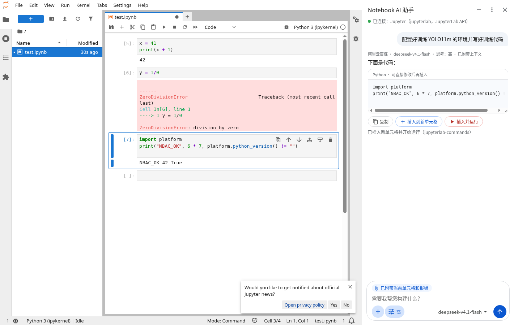
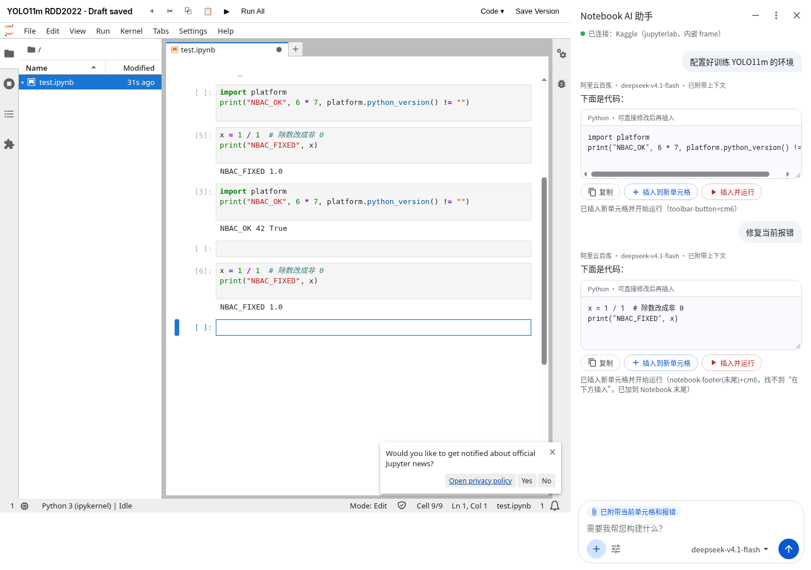

# Notebook AI Copilot

一个 Chrome 扩展（Manifest V3）：在 **飞桨 AI Studio**、**ModelScope（魔搭）**、**Kaggle**、**安睿云 JupyterLab** 的网页 Notebook 里，用**你自己的 API Key** 调大模型写代码。默认用 **阿里云百炼 + DeepSeek-V4.1-Flash**，也支持 DeepSeek 官方、Google Gemini 和任意 OpenAI 兼容接口。

> 生成的代码**先给你看**；你点“插入到新单元格”才会写进 Notebook；点“插入并运行”还要再**确认一次**才会运行。没有确认，什么都不会执行。





## 功能

- **三种模式**（0.1.13，输入框上方的「Notebook / 终端 / 聊天」切换，记住上次的选择）：
  - **Notebook**：和以前一样，写一个 Python 单元格，可以复制 / 插入到新单元格 / 插入并运行；
  - **终端**：写 bash 命令（一个 ```bash 代码块；国内平台用清华 PyPI 和 hf-mirror，非交互 `-y`，删除/覆盖类命令会加警告注释，按检测到的硬件写），可以 **复制** 到平台终端，或点 **在 Notebook 里运行**（确认后插入一个 `%%bash` 单元格并运行）；
  - **聊天**：普通问答，回答显示成文字（代码块单独显示、带复制按钮），不会改动 Notebook。
- **聊天记录会保存**（0.1.13）：存在本机 `chrome.storage.local`（键 `nbacChatHistory`，最多 200 条，不含 API Key），关掉侧边栏、换网页后再打开都还在。每条消息右上角有 **删除**（删掉的消息也不会再发给模型）；右上角 **“—”（新对话）** 或 **+ → 清空聊天记录** 会先问「清空全部聊天记录？」，确认后全部清空。
- 对话式侧边栏（中文界面）：欢迎页带常用建议，例如“配置 YOLO11 训练环境”“写 YOLO11m 训练代码”“修复当前报错”。
- 每段代码下面有 **复制 / 插入到新单元格 / 插入并运行**（运行前要确认），代码可以先在框里改。
- 输入框左下角 **“+”**：开关“附带当前单元格代码和最近的报错”、修复当前报错、**检测硬件**、重新检测 Notebook、复制诊断信息。
- **自动识别硬件**（0.1.4）：顶部状态下面显示「硬件：…」，例如安睿云页面顶栏写着 “AMD Radeon Cloud” 时显示「硬件：AMD GPU（ROCm）· 页面提示」。生成代码时按硬件写：AMD 用 ROCm（仍是 `cuda` 设备接口、用 `rocm-smi`、不装只支持 CUDA 的包）；硬件未知时让代码先做设备检测。详见下文“硬件识别”。
- **不在列表里的网站也能用**（0.1.4）：自建 JupyterLab 等网站，侧边栏会提示「在此网站启用助手」，点一下、在 Chrome 弹窗里允许即可。
- **思考强度**（调节图标）：默认 / 关闭 / 低 / 中 / 高 / 最高，按模型换成真实参数，当前模型不支持的档位会变灰。
- 输入框右下角 **模型切换**：选服务商，并用你的 Key 拉取模型列表（会缓存，可“刷新列表”），拉取失败时可以直接输入模型 ID。
- 记住上次选的服务商、模型和思考强度。
- 多个服务商的 Key 可以同时保存，在侧边栏里随时切换。
- 系统提示要求：只输出一个可运行的 Python 单元格，用 `%pip`；国内平台（AI Studio / ModelScope / 安睿云）安装时加清华镜像 `-i https://pypi.tuna.tsinghua.edu.cn/simple`，Hugging Face 用 `hf-mirror.com`。
- 纯 JS，无需构建；扩展从不 `eval` 模型输出，只把文本放进单元格。

## 安装（自己用，免费，不用上架）

1. 下载本仓库：点 GitHub 页面的 **Code → Download ZIP** 并解压（或 `git clone`）。
2. Chrome 地址栏打开 `chrome://extensions`，打开右上角 **开发者模式**。
3. 点 **加载已解压的扩展程序**，选中解压出来的文件夹（里面有 `manifest.json`）。
4. 点工具栏上的扩展图标（可先点拼图图标把它固定）打开侧边栏，点右上角 **⋮** 打开设置，填 API Key 并保存。

Chrome 偶尔会提示“停用开发者模式扩展”，点关闭即可。

**从旧版本升级**：把新代码覆盖到原来的文件夹，在 `chrome://extensions` 里点这个扩展的 **刷新（⟳）** 按钮，然后**把已经打开的 Notebook 网页都刷新一次**。

### 权限说明

| 权限 | 用途 |
|---|---|
| `sidePanel`、`storage` | 侧边栏；在本机保存设置和 API Key |
| `scripting` | 网页上没有自动加载助手脚本时（扩展刚更新、网站不在默认列表里），侧边栏用它把同一套脚本注入当前网页 |
| `activeTab` | 你点工具栏上的扩展图标时，临时允许助手访问当前这个网页 |
| 主机权限：百炼 / DeepSeek / Gemini 接口，以及 AI Studio、ModelScope、Kaggle、安睿云（`*.anruicloud.com`）的网址 | 调模型接口；在这些平台的 Notebook 里读单元格、插入和运行 |
| 可选主机权限 `https://*/*`、`http://*/*` | **安装时不申请**。只有你在侧边栏点「在此网站启用助手」（或保存自定义接口地址）时，Chrome 才会弹窗只申请那一个网站 |

`scripting`、`activeTab` 不会触发新的权限警告；新增的主机权限和原来内容脚本匹配的网址相同，所以从 0.1.3 升级时 Chrome 不会因为权限变化停用扩展（开发者模式下加载的扩展本来也不会）。

## 服务商和模型

| 服务商 | 接口地址 | 默认模型 | 说明 |
|---|---|---|---|
| **阿里云百炼**（默认） | `https://dashscope.aliyuncs.com/compatible-mode/v1` | `deepseek-v4.1-flash` | 这个 ID 对应 DeepSeek-V4.1-Flash 的最新版 1017；文档里也列出了快照 `deepseek-v4.1-flash-1017`，可在模型列表里切换。同一个 Key 还能用 `qwen3.8-max`、`kimi-k3`、`glm-5.3` 等。带 “/” 的第三方模型要先在百炼控制台开通，否则会返回 400“未开通”；有些旧模型会返回 403，侧边栏会直接告诉你原因。 |
| DeepSeek 官方 | `https://api.deepseek.com` | `deepseek-flash` | 官方文档说明 `deepseek-flash` 目前由 DeepSeek-V4.1-Flash-1017 提供。 |
| Google Gemini | `https://generativelanguage.googleapis.com/v1beta` | `gemini-3.5-flash` | Google 已在 2026-10-08 把 3.5 Flash 标为弃用，请求会自动转到 `gemini-3.6-flash`；也可以选 `gemini-3.6-flash`、`gemini-3.8-flash`。国内网络通常无法直连。免费 Key：[Google AI Studio](https://aistudio.google.com/apikey)。 |
| 自定义（OpenAI 兼容） | 自己填（到 `/v1` 为止） | 自己填 | 保存时 Chrome 会弹窗请求访问该网站的权限，请点允许。 |

模型列表：OpenAI 兼容接口调用 `GET {Base URL}/models`，Gemini 调用 `models.list`。列表会去掉语音、向量、图像这类不能对话的模型。

### 思考强度怎么映射

| 档位 | DeepSeek 官方 | 百炼 deepseek-v4.x | 百炼 qwen | 百炼 kimi / glm | Gemini 3.x | 自定义 |
|---|---|---|---|---|---|---|
| 默认 | 不传参数 | 不传参数 | 不传参数 | 不传参数 | 不传参数 | 不传参数 |
| 关闭 | `thinking:{type:"disabled"}` | `enable_thinking:false` | `enable_thinking:false` | `enable_thinking:false` | `thinkingLevel:"minimal"`（3.8 不支持） | — |
| 低 | `thinking:{type:"enabled"}` + `reasoning_effort:"low"` | `enable_thinking:true` + `reasoning_effort:"low"` | `thinking_budget:1024` | — | `thinkingLevel:"low"` | `reasoning_effort:"low"` |
| 中 | — | — | `thinking_budget:4096` | — | `"medium"` | `"medium"` |
| 高 | `reasoning_effort:"high"` | `reasoning_effort:"high"` | `thinking_budget:16384` | `enable_thinking:true` | `"high"` | `"high"` |
| 最高 | `reasoning_effort:"max"` | `reasoning_effort:"max"` | `enable_thinking:true`（不限预算） | — | — | — |

“—”表示这个模型不支持该档位，侧边栏里会变灰。如果服务商拒绝了思考参数（返回 400），扩展会去掉参数自动重试一次，并在输入框上方提示。

## 使用

1. 打开平台的 Notebook，等内核启动、页面加载完。
2. 打开侧边栏，顶部显示绿色的“已连接：xxx”就行（没连上就点 **+ → 重新检测 Notebook**）。
3. 在底部输入需求，按回车发送（Shift+回车换行）→ 检查代码 → **插入到新单元格**，或 **插入并运行 → 确认运行**。
4. 运行报错时：先点一下出错的单元格，再点 **+ → 修复当前报错**（或欢迎页的“修复当前报错”）。

## 各平台说明

| 平台 | 匹配的网址 | 适配方式 |
|---|---|---|
| 飞桨 AI Studio（BML Codelab，基于 JupyterLab） | `aistudio.baidu.com`、`*.aistudio.baidu.com` | `#jupyterlab-frame` iframe 里的 JupyterLab 走 JupyterLab 适配器（支持 Monaco 编辑器）；外层项目编辑器不支持，见下文 |
| ModelScope Notebook | `modelscope.cn`、`*.modelscope.cn` | 免费 CPU 实例的 Code Editor（VS Code 网页版）走 **VS Code Notebook 适配器**；打开的是 JupyterLab 时走 JupyterLab 适配器 |
| ModelScope DSW（GPU 实例，阿里云 PAI-DSW） | `*.data.aliyun.com`（如 `dsw-gateway-cn-hangzhou.data.aliyun.com/dsw-xxxx/lab?appId=MAAS&…`） | 顶层页面就是 JupyterLab，走 JupyterLab 适配器；侧边栏显示「ModelScope DSW」，连接后在内核里静默检测硬件 |
| Kaggle（`www.kaggle.com/code/.../edit`） | `www.kaggle.com`、`*.kaggleusercontent.com`、`*.kaggle.net`（单元格所在的 `kkb-production.jupyter-proxy.kaggle.net` iframe） | iframe 里的 JupyterLab 4 走 JupyterLab 适配器；顶层 kaggle.com 页面没有单元格，会回报“不是 Notebook” |
| 安睿云 JupyterLab（`jupyter.anruicloud.com/instances/<实例>/lab`） | `*.anruicloud.com`（包括 `jupyter.anruicloud.com` 的任意路径，如 `/instances/<实例>/lab`、`/instances/<实例>/lab/tree/…`） | 顶层页面就是标准 JupyterLab，走 JupyterLab 适配器（直接写单元格模型）；侧边栏显示「安睿云 JupyterLab」 |

内容脚本在所有 iframe 里都会运行（`all_frames`）。检测时每个 frame 都会回报自己是不是 Notebook，侧边栏按 `frameId` 选出真正有单元格的那个 frame（JupyterLab 优先、单元格多的优先），之后的读取、插入、运行都只发给这个 frame。Notebook 晚加载时，侧边栏会每 3 秒自动重试检测（最多约 1 分钟）。

**JupyterLab 适配器**（按顺序兜底）：
1. 页面暴露了 `window.jupyterapp` 时，直接用 JupyterLab 命令：`notebook:insert-cell-below`、`notebook:run-cell`，并写 `activeCell.model.sharedModel.setSource()`；
2. 没暴露时（AI Studio、Kaggle、ModelScope DSW 等都不暴露），**直接操作 JupyterLab 的单元格模型**，不往编辑器里“打字”：
   - 一个很小的 `document_start` 脚本（`early.js`）记下 Lumino widget 以对象形式注册的事件监听器，从而由 `.jp-Notebook` 节点找到 Notebook widget；
   - 或者从页面的 webpack 运行时（`webpackChunk*` → module federation 共享作用域 / 模块缓存）取出页面正在用的 `@jupyterlab/notebook`，用 `NotebookActions.insertBelow` / `run`；
   - 然后 `activeCell.model.sharedModel.setSource(code)`（JupyterLab 3 用 `model.value.text`），写完核对模型里的内容和原文一致。这条路对 CodeMirror、Monaco 等任何编辑器都一样；
3. 找不到模型时才走 DOM：点 Notebook 工具栏里 `[data-command="notebook:insert-cell-below"]` / `[data-command="notebook:run-cell-and-select-next"]` 按钮。工具栏被平台用 CSS 藏起来时，隐藏的按钮照样能用。代码用 CodeMirror 6 的 `EditorView`（`.cm-content.cmView.view`）写入，CodeMirror 5 用 `.CodeMirror.CodeMirror.setValue()`，Monaco 先用 Monaco API（`window.monaco` 或 AMD loader 里的 `vs/editor/editor.main`），再依次试粘贴事件、EditContext `textupdate`、`execCommand`、`beforeinput`，每次都核对；
4. 页面上根本没有这些按钮时：页面有焦点就模拟 Esc → B；没有焦点（比如你刚点了侧边栏，JupyterLab 的 B 快捷键需要焦点）就点 Notebook 底部的“添加单元格”区域，这时新单元格会加在**末尾**。运行用 Shift+Enter（不需要焦点）。
5. 全都写不进去时不会运行，代码自动复制到剪贴板，提示你手动粘贴。
报错读取：`.jp-OutputArea-output[data-mime-type="application/vnd.jupyter.stderr"]`。

**飞桨 AI Studio**（2026-11 对照真实已登录 AI Studio 的 DOM 结构核对过）：
- **请在 BML Codelab 里用**：打开项目后点「**专业开发**」进入 BML Codelab（地址类似 `aistudio.baidu.com/bj-cpu-01/user/…/…/home#codelab`）。
- 外层的项目编辑器（`/project/edit/…`）是 AI Studio 自己的页面，DOM 里没有足够稳定的单元格结构，**暂不支持**；在那里打开侧边栏会提示“请点击「专业开发」打开 BML Codelab 后使用”。
- BML Codelab 的宿主页同源嵌了两个 iframe：`#vscode-frame`（VS Code，里面还有 webview 子 iframe）和 `#jupyterlab-frame`（JupyterLab，单元格在这里）。宿主页和 VS Code 那些 frame 都会回报“不是 Notebook”，侧边栏只连 `#jupyterlab-frame`。
- 那里的 JupyterLab 是中文界面（如按钮标题“下方插入单元格 (B)”），单元格编辑器是 **Monaco**（旧版，隐藏的 `textarea.inputarea`），不暴露全局 `window.monaco`。扩展只靠 `data-command`、class 这些不随语言变化的选择器。
- **0.1.1 起优先通过 JupyterLab 单元格模型写代码**（见上面第 2 条），不再依赖往 Monaco 里粘贴（0.1.0 在真实页面上报“写入 Monaco 编辑器失败”）。找不到模型时才退回到 Monaco API → 粘贴等方式，最后复制到剪贴板。读代码也优先读模型（完整内容），否则读渲染出来的行。
- 测试里在本机仿造了这个结构：同源宿主页 + `#vscode-frame` 诱饵（含嵌套 iframe）+ `#jupyterlab-frame` 里经反向代理的真实中文 JupyterLab 4；另有一个照抄真实 DOM、用真实 Monaco（去掉全局）的单元格夹具（运行是假的）。检测、读代码和报错、插入、确认后运行、修复报错、外层编辑器提示都通过了。**还没有在真正的 AI Studio 上端到端跑过。**

**ModelScope**（2026-11 对照真实 ModelScope 免费 CPU 实例的 DOM 结构核对过）：
- 在「我的 Notebook」里启动实例后点「查看 / View」，打开的是 `modelscope.cn/code/workspace?instanceId=…`。它**不是 JupyterLab**，而是 VS Code 网页版的 Code Editor：外层页面同源嵌了 `iframe[title="notebook-ide"]`（`/notebook/main.html`），`.ipynb` 用 VS Code 自带的 Notebook 编辑器打开。侧边栏只连这个 frame；外层页面、`extensionHostIframe.html` 都回报“不是 Notebook”，`g.alicdn.com` 上的跨域 webview 不注入。
- 还没打开 `.ipynb` 时会提示新建一个（File → New File… → Jupyter Notebook）；在「我的 Notebook」列表页会提示先启动实例再点「查看」。
- 读代码：当前单元格是 `.monaco-list-row.code-cell-row.focused`，代码从 Monaco 渲染出来的行（`.view-lines`）读取。
- 插入（0.1.1 起放宽了查找，0.1.0 在真实页面上报“没有找到可用的 + Code 按钮”）：先模拟鼠标移到当前单元格上（有的按钮只在悬停时出现），再按 `aria-label` / `title` / 文字匹配 “Add Code Cell / + Code / Code / 代码 / 添加代码单元格”（允许带快捷键后缀），依次试当前单元格下方的按钮、Notebook 工具栏、顶部插入条、整个编辑器里的动作栏；每个按钮发完整的 pointerdown → mousedown → pointerup → mouseup → click，然后等单元格总数（`aria-setsize`）变化，避免重复插入。都不行就聚焦单元格列表按 Esc → B。还不行、但当前选中的单元格是空的，就直接写进这个空单元格。
- 写代码：单元格编辑器是 Monaco，用 EditContext（`.native-edit-context`），没有全局 `monaco`。依次试：① 对编辑器发一个“粘贴”事件；② 发一次 EditContext `textupdate`；③ `document.execCommand('insertText')`；④ `beforeinput`。每试一次都核对渲染出来的代码和原文完全一致（缩进、括号都不能差）。都不行时**不会运行**，代码会复制到剪贴板，提示你在新单元格里按 Ctrl+V。
- 运行：确认后点这个单元格的运行按钮（`.run-button-container a.codicon-notebook-execute`）。
- 报错：VS Code 把输出画在单独的跨域 webview 里，扩展通常**读不到输出文字**。这时“修复当前报错”会提示你把报错复制到输入框里，再点“修复当前报错”，贴进来的内容会当作报错发给模型。
- 内核：实测 `/usr/bin/python3`（Python 3.10.12）没有 ipykernel，运行会报 “requires the ipykernel package”，也装不了 pip。检测到这种内核或这条报错时，侧边栏会提示：点 Notebook 右上角的内核名，改选 `/usr/local/bin/python`（Python 3.11）。
- **注意**：这些只对照抓下来的真实 DOM，在本机仿造的页面（真实 monaco-editor + EditContext，运行是假的）上测过，**没有在真实 ModelScope 页面里装上扩展跑过**。

**安睿云 JupyterLab**（0.1.2 起）：
- 打开 `https://jupyter.anruicloud.com/instances/<实例>/lab`，在左侧双击一个 `.ipynb`（或在启动器里新建 Notebook）后打开侧边栏即可。只停在启动器/文件浏览器时，侧边栏会提示先打开 Notebook；打开后会自动重新检测（也可以点“+ → 重新检测 Notebook”）。
- 页面没有暴露 `window.jupyterapp`，扩展通过 JupyterLab 单元格模型插入和写代码（见上面 JupyterLab 适配器第 2 条），运行用 `NotebookActions.run` 或工具栏按钮 / Shift+Enter。
- 这是国内云，系统提示里会让 pip 加清华镜像。
- 只在本机仿造的同样路径（`/instances/<id>/lab`，真实 JupyterLab 4，不暴露 app）上测过；真实站点需要登录（未登录访问返回 403），**没有在真实安睿云页面上装上扩展跑过**。如果不行，请用“+ → 复制诊断信息”。

**其他网站 / 自建 JupyterLab**：
- 打开 Notebook 后打开侧边栏。如果网站不在上表里，侧边栏会说“助手还没有访问这个网站的权限”，并显示 **「在此网站启用助手」** 按钮：点它，Chrome 会弹窗询问是否允许访问这个网站（只申请这一个域名），允许后立即生效，以后打开这个网站会自动加载。
- 已有权限但网页没加载助手脚本时（比如扩展刚更新、网页没刷新），侧边栏会自动把脚本注入当前网页，并提示“已经在当前网页里手动加载好了”。
- 如果 Chrome 由公司/学校管理，并且组织策略禁止扩展访问这个网站，侧边栏会直接说明“组织策略禁止扩展在这个网站上运行”，并附上 Chrome 的原始报错（“复制诊断信息”里也有）。这种情况扩展自己没法绕过，需要管理员放行，或换一个不受管理的 Chrome 用户资料。

### 硬件识别（AMD / NVIDIA / CPU）

- **页面提示**：检测 Notebook 时顺便读平台页面上的非 Notebook 文字（顶栏、实例规格；不读单元格代码和输出），认出 “AMD Radeon Cloud”、Radeon/Instinct/MI300、NVIDIA/Tesla/A100/V100/“GPU T4 x2”/P100 等字样和显存；ModelScope 网址里的 `acceleratorType=CPU/GPU` 也会用上。
- **检测硬件**：点 **+ → 检测硬件（GPU / CPU）**，侧边栏给出一段只读的检测代码（看 PyTorch 能不能用 GPU、`torch.version.hip` 还是 `torch.version.cuda`、显卡型号和显存；没有 torch 时看 `rocm-smi` / `nvidia-smi`，不安装任何东西），照常 **插入并运行 → 确认运行**，运行完会自动读回输出里 `NBAC_HW {…}` 那一行并保存（按网页地址保存 12 小时）。输出读不到的平台（ModelScope Code Editor）把那一行复制到输入框发送即可。
- 优先级：检测结果 > 页面提示 > 网址推断。顶部状态下面会显示「硬件：AMD GPU（ROCm）· 页面提示」「硬件：仅 CPU · 已检测」这样的文字。
- 给模型的规则：**AMD** → 用 ROCm 版 PyTorch，它仍用 `torch.cuda` / `device="cuda"`；看显卡用 `rocm-smi`；不要装 bitsandbytes 的 CUDA 版、flash-attn 等只支持 CUDA 的包；已有能用的 torch 就别重装，必须装时用 `https://download.pytorch.org/whl/rocm6.x`。**NVIDIA** → CUDA。**只有 CPU** → `device="cpu"` 并调小规模。**未知** → 代码开头先做设备检测（`torch.cuda.is_available()`、`torch.version.hip`、`torch.version.cuda`、设备名，没有 GPU 就用 CPU）。

**Kaggle**（2026-11 对照真实已登录 Kaggle Notebook 的 DOM 结构核对过）：
- 顶层 `www.kaggle.com` 是 Kaggle 自己的 React/MUI 页面（工具栏有 Add cell、Run current cell、Run All 等），**没有单元格**；
- 单元格在 `<iframe name="notebook-editor-cells" title="Notebook editor cells">` 里，地址是 `https://kkb-production.jupyter-proxy.kaggle.net/static/assets/jupyterlab-v4/jupyterlab-index-….html?session=…`，里面是标准 JupyterLab 4（`.jp-NotebookPanel > .jp-WindowedPanel-outer`、`.jp-Cell`、CodeMirror 6，也有 `data-command` 工具栏按钮）；
- 扩展在这个 iframe 里用上面的 JupyterLab 适配器；不确定 Kaggle 是否暴露 `window.jupyterapp`，所以不依赖它。
- 测试里用本机仿造了这个结构：顶层仿 kaggle.com 页面 + 另一个站点的 iframe 里嵌真实 JupyterLab 4（不暴露全局 app），检测、读代码和报错、插入、确认后运行、修复报错、工具栏隐藏/缺失时的兜底都通过了。**还没有在真正的 Kaggle 上端到端跑过**（测试用的托管 Chrome 里装不了这个扩展）。
- 旧的“Kaggle DOM 适配器”（找 `+ Code` 按钮、`.cm-editor` 等）保留为兜底，只在页面里没有 JupyterLab 但有编辑器时才用，目前没有测试覆盖。

如果插入失败，侧边栏会显示原因，代码可以点“复制”后手动粘贴。

## 出问题时：复制诊断信息

在真实网站上插入/写入失败时：

1. 打开出问题的 Notebook 页面，打开侧边栏；
2. 点输入框左边的 **+ → 复制诊断信息**；
3. 侧边栏提示“诊断信息已复制到剪贴板”后，直接粘贴发给开发者（如果复制失败，信息会显示在侧边栏的框里，全选复制即可）。

诊断信息是一段 JSON：每个 frame 的地址（不含 `?` 后面的参数）、识别出的适配器、关键选择器的数量（`.jp-Notebook`、`.monaco-editor`、`textarea.inputarea`、`.native-edit-context`、`.notebook-editor`、`.code-cell-row` 等）、有哪些全局变量（`jupyterapp`、`monaco`、`require`、`webpackChunk*`）、JupyterLab 版本、是否找到了单元格模型、ModelScope 的候选按钮列表（标签、class、aria-label、title、文字，最多 60 个），以及最近一次插入/写入失败的错误和步骤。**不包含代码、输出和 API Key。**

## 已知限制

- 界面风格参考了常见的 Notebook AI 侧边栏，只是自己用；扩展里没有用任何其他公司的标志或名称。
- 无法登录三个平台做实测：JupyterLab 适配器在真实 JupyterLab 4.6 上测过；AI Studio（BML Codelab）、ModelScope（Code Editor）和 Kaggle 都只在本机按真实 DOM 仿造的结构上测过，没在真实平台上装上扩展跑过。ModelScope 的输出通常读不到，报错要自己贴进输入框。AI Studio 的 Monaco 单元格只能读到当前渲染出来的行，特别长的单元格可能读不全。
- 插入位置是“当前选中单元格的下方”。
- Gemini API 在中国大陆网络下通常无法直连。
- 模型生成的代码可能有错，请一定先检查再运行，尤其是删除文件、下载大文件的命令。
- 自己用不需要上架；上架 Chrome 应用商店需要一次性 5 美元开发者注册费。

## 测试

见 [tests/README.md](tests/README.md)：真实 JupyterLab + Playwright + 本地模拟模型服务的端到端测试。

## 隐私

见 [PRIVACY.md](PRIVACY.md)。API Key 只存在本机 `chrome.storage.local`。聊天记录（包括附带的单元格代码和报错）也只存在本机 `chrome.storage.local`，可以随时单条删除或清空。

## 许可证

MIT
